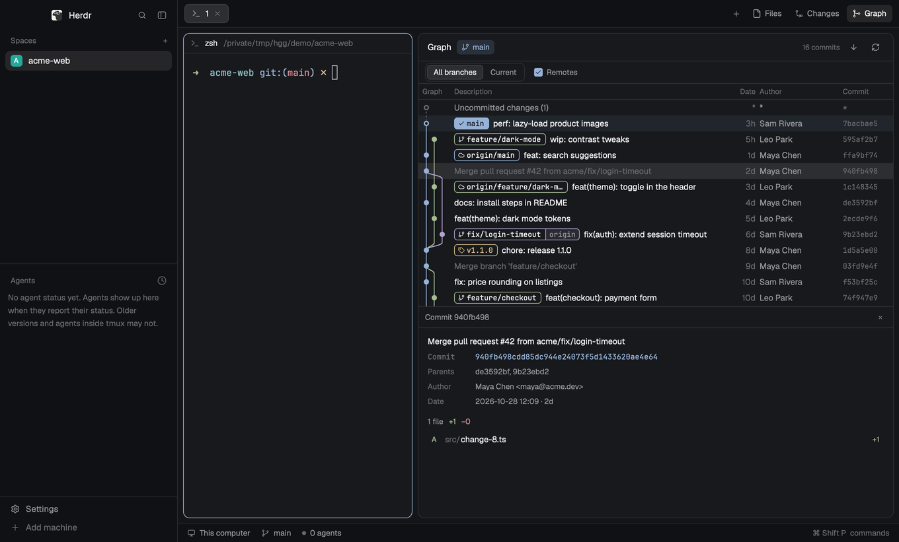

# Git Graph for Herdr

A commit graph for the [Herdr](https://herdr.dev) desktop app, in the spirit of
VS Code's [Git Graph](https://github.com/mhutchie/vscode-git-graph) extension:
every branch's history as colored lanes, branch and tag labels, and the git
actions you'd want from them, one double-click or right-click away. It follows
the repository of the terminal you're focused on.



Written from scratch as a native Herdr mod (no web view, no code from the VS Code
extension).

## What it does

- **The graph.** Git Graph's table (graph, description, date, and when there's room
  author and commit), newest first, with a lane per branch and curves where
  branches fork and merge. Merge commits are muted.
- **Where you are.** The checked-out branch's label is filled with a ✓, the header
  shows the branch, and HEAD is a ring on a tinted row.
- **Labels.** Local branches carry their remote (`main | origin`), remote-only
  branches and tags have their own. Toggle remote branches, and all branches or
  just the current one, from the toolbar.
- **Uncommitted changes** sit on top as their own row, joined to HEAD by a dashed
  line.
- **Double-click a branch label** to check it out. A remote branch with no local
  one asks for the local name first.
- **Right-click** what's under the pointer:
  - a branch: checkout, rename, delete, merge into the current branch, rebase onto it, push, copy name
  - a remote branch: checkout, merge, delete it on the remote, copy name
  - a tag: delete, push, copy name
  - a commit: add tag, create branch, checkout, cherry pick, revert, merge, rebase, reset (soft, mixed, hard), copy hash or subject
  - uncommitted changes: stash, reset, show them in Herdr's Changes panel
- **Commit details.** Click a commit for its message, hash, parents, author, date
  and changed files; click a file for its diff.
- **Live.** It reloads when refs move (a commit, checkout or fetch from any
  terminal), refreshes the uncommitted row as you edit, and fetches with one
  button. 300 commits at first, and 300 more each time you scroll to the end.
- **Fast to switch.** Every repository you've looked at is kept, and the ones open
  in your other spaces are read ahead, so switching agents shows its graph at
  once (then checks for changes in the background). Clicking a commit shows its
  header at once; the files follow, and a commit you've opened before is instant.

Everything that changes the repository asks first in a dialog, except checking
out a local branch and the Fetch button. Destructive choices are red, and when
git refuses, its own message stays in the dialog.

## What it runs

The mod runs `git` in the focused repository (on its machine, for spaces on
another machine) and reads files there to show an untracked file's contents. It
reaches the network only through git, when you press Fetch, Push, or delete a
remote branch. It never runs a shell: every git call is an argument list, and
names you type can't start with `-`.

## Install

Ask your Herdr agent: *"add the mod at github.com/rabeeh-ta/herdr-git-graph"*.
It reads [RECIPE.md](RECIPE.md) and the files, copies `mods/git-graph/` into
`~/.config/herdr-app/mods/`, and checks it.

Or by hand:

```sh
git clone https://github.com/rabeeh-ta/herdr-git-graph
cp -R herdr-git-graph/mods/git-graph ~/.config/herdr-app/mods/
```

If you already have a mod called `git-graph`, rename this one's folder, and the
`mods/git-graph/` paths and `mod: "git-graph"` names inside it, to match.

### Put it in the top bar

Herdr's tab bar has Files and Changes buttons. [docs/top-bar.md](docs/top-bar.md)
adds Graph beside them (your agent can do it in a minute), by cloning Herdr's
`main` layout and `tabs` mod.

### Or open it as a pane

Beside a terminal, for a wider view of one repository:

```sh
herdr-app do pane.split '{"direction":"right","mod":"git-graph","props":{"folder":"/path/to/repo"}}'
```

## Limits

- Tested on macOS with Herdr 0.1.9. Linux and Windows aren't tested yet.
- Labels clip when a row has many.
- A very large history loads slower the first time if the repository has no
  commit-graph file (a fresh clone usually doesn't): openedx-platform, 78k
  commits, takes about half a second. `git commit-graph write --reachable` (or
  `git maintenance start`) in that repository brings it to about 60 ms.
- Not in this version: Git Graph's find (Ctrl+F), a branch-picker dropdown, pull,
  interactive rebase, and per-file actions in commit details.

## Development

```sh
node tests/graph.test.mjs
```

The tests build throwaway repositories (with a bare "remote") and check the
parsing, lanes, label positions, menus, validation, and every action against
real git. The UI was checked in an isolated Herdr window (`HERDR_APP_HOME` and
`HC_SESSION` pointed at a scratch folder).

## License

MIT, see [LICENSE](LICENSE). Most icons are drawn after
[Lucide](https://lucide.dev) (ISC, see `mods/git-graph/icons/LICENSE-lucide.txt`).
